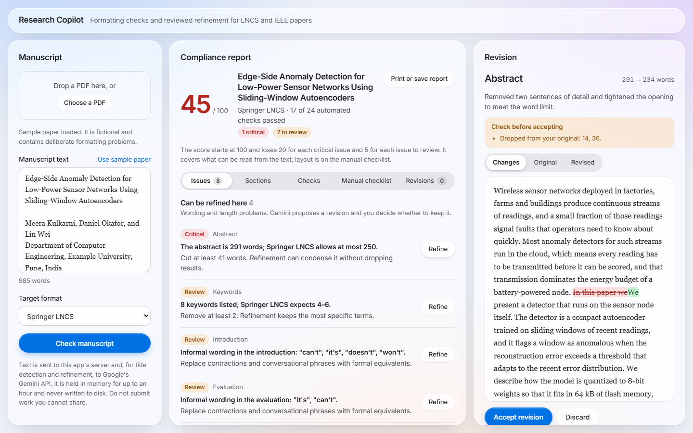

# Research Copilot

Checks a research manuscript against Springer LNCS or IEEE conference formatting rules, and uses Gemini to refine one section at a time. The report is the paper itself, set as a page with each problem marked where it occurs and explained in the margin. Every suggested revision is shown as tracked changes in place and is only applied when the author accepts it.

**Live demo:** [research-copilot-eight.vercel.app](https://research-copilot-eight.vercel.app). The API runs on a free instance that sleeps when idle, so the first request can take up to a minute. Use the "Try the sample paper" link to see it work without a manuscript.



## What it does

1. Paste manuscript text or upload a PDF.
2. Pick a target format: Springer LNCS or IEEE Conference.
3. Get the paper back marked up: offending phrases are underlined in the text and each issue sits in the margin beside the section it concerns. A pass/fail table of every automated check and a checklist of layout rules that cannot be verified from text are one tab away.
4. Ask for a refinement of a section. The revision appears in the paper as a word-level diff.
5. Accept or discard it. Accepting re-runs the checks.
6. Print or save the report, including the full text of accepted revisions.

It does not generate papers, check plagiarism, manage citations, or verify layout (fonts, margins, columns). It works on text only.

## How it works

```
text or PDF
  → PDF text extraction (pdf.js), running heads removed, hyphenated words rejoined
  → section parser: numbered and standard headings, validated by numbering sequence
  → Gemini: title / abstract / keywords from the first page, kept only if found verbatim in the source
  → rule engine: deterministic checks driven by a profile config
  → report

refine a section
  → Gemini (JSON mode, fixed schema, low temperature) with the failed rules as requirements
  → deterministic check: every number and citation in the original must survive; none may be added
  → one retry with the specific failure, then remaining problems are shown to the author as warnings
  → diff → accept or discard
```

Design decisions worth knowing about:

- **The score never comes from the model.** All checks are regular code in [evaluateCompliance.js](backend/src/rules/evaluateCompliance.js). The score is `100 − 20 × critical − 5 × review`.
- **Gemini is optional for analysis.** If the API key is missing, rate-limited or down, parsing falls back to rules alone and the report still renders. Only refinement needs Gemini.
- **Model output is checked, not trusted.** Extracted fields must appear word for word in the manuscript. Revisions are compared against the original for changed numbers and citations ([preservation.js](backend/src/ai/preservation.js)).
- **Only some issues are refinable.** Length, wording and keyword count can be fixed by rewriting. Missing sections, reference format, heading numbering and captions are marked as manual, because fixing them would require the model to invent content or restructure the paper.
- **References are never sent for rewriting.**

## Checks

| Area | Checks |
|---|---|
| Structure | required sections present, section order, heading numbering style, heading depth, unnumbered acknowledgements |
| Title | no trailing period, not all capitals |
| Abstract | word count within the profile range, no citations |
| Keywords | count within range, label matches the format ("Keywords" or "Index Terms") |
| Citations | numeric in-text style, numbered reference list |
| Figures and tables | caption format for the profile |
| Language | undefined acronyms, contractions and conversational phrases per section |
| Other | author e-mail on the first page, page estimate from word count |

Profile values live in [backend/src/profiles](backend/src/profiles). They follow the publishers' general author guidelines; a specific conference can be stricter, so confirm limits against your call for papers.

## Stack

| Layer | Tech |
|---|---|
| Frontend | React 19, Vite, plain CSS, [jsdiff](https://github.com/kpdecker/jsdiff). Deployed on Vercel |
| Backend | Node.js, Express 5, pdf-parse, express-rate-limit. Deployed on Render |
| AI | Gemini API via `@google/generative-ai`, with a fallback model |
| Storage | In-memory sessions, one-hour idle expiry, capped at 200 |

## Run locally

Requires Node 22.3 or newer.

```bash
# API
cd backend
npm install
cp .env.example .env    # add GEMINI_API_KEY; the API also runs without one
npm run dev             # http://localhost:4000

# Web app
cd frontend
npm install
npm run dev             # http://localhost:5173
```

```bash
cd backend && npm test  # parser, rule engine, preservation check, refinement retry, HTTP API
```

### Environment variables

| Variable | Where | Purpose |
|---|---|---|
| `GEMINI_API_KEY` | backend | Gemini key. Optional for analysis, required for refinement |
| `GEMINI_MODEL`, `GEMINI_FALLBACK_MODEL` | backend | Model overrides |
| `ALLOWED_ORIGINS` | backend | Comma-separated frontend origins allowed by CORS |
| `VITE_API_URL` | frontend | Base URL of the API |

## API

| Method | Path | Body | Returns |
|---|---|---|---|
| POST | `/api/extract-pdf` | multipart, field `pdf` | `{ text, pages, truncated }` |
| POST | `/api/analyze` | `{ text, profile }` | `{ sessionId, title, extraction, report, document }` |
| POST | `/api/reanalyze` | `{ sessionId, profile }` | `{ report }` for a different profile, no Gemini call |
| POST | `/api/refine-section` | `{ sessionId, section }` | `{ suggestion }` |
| POST | `/api/apply-suggestion` | `{ sessionId, section }` | `{ report, revisions, document }` |

`document` is the parsed paper (byline, sections, sub-headings) that the client draws. Each issue in `report` may carry `evidence`: the exact phrases that triggered it, which the client marks in the text.

Errors are `{ "error": "message" }` with a matching status code. A lost session returns 404 with `"code": "SESSION_EXPIRED"`.

## Project structure

```
backend/
  src/
    app.js, server.js       Express app and entry point
    routes/                 one file per endpoint
    manuscript/             text cleanup, section parser, PDF text handling
    rules/                  compliance checks
    profiles/               LNCS and IEEE rule values and manual checklists
    ai/                     Gemini client, front-matter extraction, refinement, preservation check
    store.js                in-memory sessions
  tests/
frontend/
  src/
    App.jsx                 state and layout
    api.js                  API calls
    proof.js                places marks and margin notes on the paper
    components/             form, marked-up paper, margin notes, diff, printable report
```

## Limitations

- Text only. Fonts, margins, columns and figure placement are not checked; they are listed as a manual checklist.
- Headings are found by numbering and by a list of standard names. An unnumbered, non-standard heading is not recognised and its text is folded into the previous section.
- Scanned PDFs are rejected; there is no OCR. Multi-column reading order depends on how the PDF was produced.
- The preservation check covers numbers and citation markers. It does not detect a claim that was reworded into a different claim, which is why every revision needs the author's review.
- Sections over roughly 1,800 words cannot be refined in one pass.
- Sessions live in memory. A server restart loses them, and the app cannot scale past one instance without moving them to a shared store.
- Page count is estimated from word count and ignores figures and tables.
